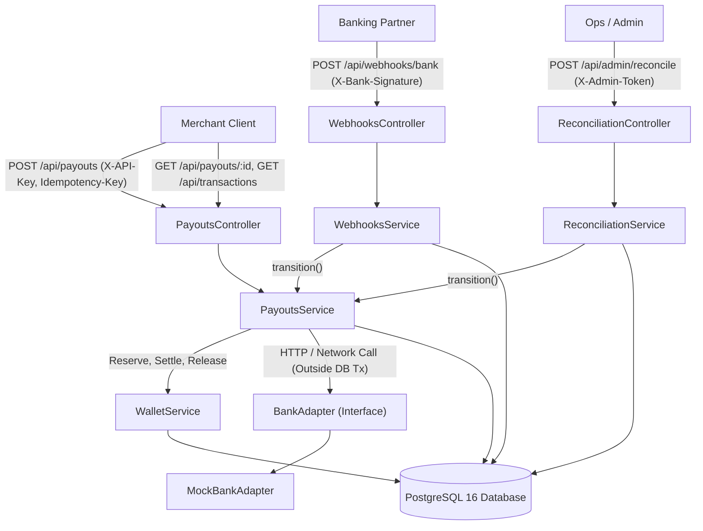
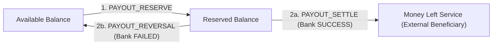
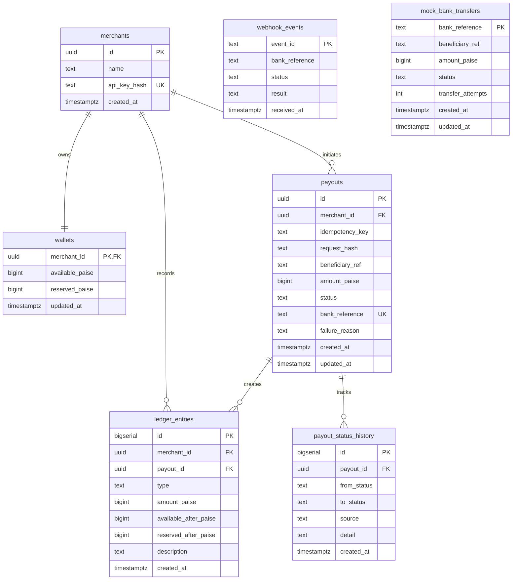
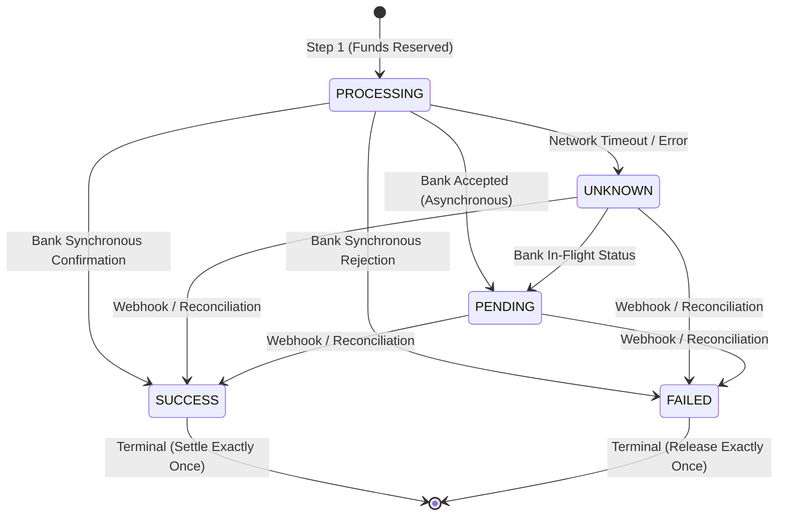

# System Architecture & Design

This document details the architectural principles, data models, state machine transitions, concurrency mechanisms, and financial accounting guarantees implemented in the Merchant Payout Service.

---

## 1. High-Level System Architecture



---

## 2. Financial Accounting & Wallet Model

### 2.1 The Two-Bucket Wallet Architecture
All monetary amounts are strictly maintained as **integer paise** (`BIGINT` in PostgreSQL, `1 INR = 100 paise`). Floating-point arithmetic is prohibited across the codebase.

Each merchant wallet maintains two balance buckets:
1. **`available_paise`**: Funds available to spend on new payouts.
2. **`reserved_paise`**: Funds committed to in-flight payouts where the bank has not confirmed final settlement or rejection.



### 2.2 Ledger Operation Lifecycle

| Ledger Operation | Available | Reserved | When Executed | Description |
| :--- | :---: | :---: | :--- | :--- |
| **`CREDIT`** | `+Amount` | `0` | Opening balance / Top-up | Funds added to merchant wallet. |
| **`PAYOUT_RESERVE`** | `-Amount` | `+Amount` | Payout Creation (Tx 1) | Holds funds while the bank processes the transfer. |
| **`PAYOUT_SETTLE`** | `0` | `-Amount` | Bank Confirmation: `SUCCESS` | Payout confirmed; reserved funds leave the system. |
| **`PAYOUT_REVERSAL`** | `+Amount` | `-Amount` | Bank Confirmation: `FAILED` | Payout rejected; reserved funds restored to available. |

### 2.3 Accounting Guarantees
- **Append-Only Ledger**: Database triggers (`forbid_update_delete()`) prohibit `UPDATE` and `DELETE` on `ledger_entries`.
- **Self-Auditing Snapshots**: Every ledger entry stores `available_after_paise` and `reserved_after_paise`.
- **Database CHECK Constraints**: `CHECK (available_paise >= 0)` and `CHECK (reserved_paise >= 0)` prevent negative balances.
- **Terminal Mutual Exclusion**: Unique index `ledger_terminal_once_per_payout` guarantees a payout cannot have both `PAYOUT_SETTLE` and `PAYOUT_REVERSAL`.

---

## 3. Entity-Relationship Model



---

## 4. Concurrency & Two-Phase Transaction Isolation

To prevent holding database connection pool locks while awaiting third-party network I/O, the payout process executes in two distinct database transactions separated by the external bank API call:

```mermaid
sequenceDiagram
    autonumber
    actor Client as Merchant Client
    participant API as PayoutsController
    participant Svc as PayoutsService
    participant DB as PostgreSQL
    participant Bank as BankAdapter

    Client->>API: POST /api/payouts (Idempotency-Key)
    API->>Svc: create(merchantId, key, dto)

    rect rgb(240, 248, 255)
        Note over Svc,DB: Transaction 1: Wallet Reservation & Payout Creation
        Svc->>DB: BEGIN
        Svc->>DB: SELECT 1 FROM wallets WHERE merchant_id = $1 FOR UPDATE
        Svc->>DB: SELECT * FROM payouts WHERE merchant_id = $1 AND idempotency_key = $2
        alt Payout Already Exists
            Svc->>DB: COMMIT
            Svc-->>API: Return existing payout (Replayed)
            API-->>Client: 200 OK (Idempotent-Replayed: true)
        else New Payout Request
            Svc->>DB: INSERT INTO payouts (status = 'PROCESSING') ON CONFLICT DO NOTHING
            Svc->>DB: UPDATE wallets SET available -= $2, reserved += $2 WHERE available >= $2
            Svc->>DB: INSERT INTO ledger_entries (type = 'PAYOUT_RESERVE')
            Svc->>DB: INSERT INTO payout_status_history
            Svc->>DB: COMMIT
        end
    end

    rect rgb(255, 250, 240)
        Note over Svc,Bank: External Network Call (No DB Locks Held)
        Svc->>Bank: transfer(bankReference, beneficiaryRef, amount)
        Bank-->>Svc: Response (SUCCESS | FAILED | PENDING | TIMEOUT)
    end

    rect rgb(240, 255, 240)
        Note over Svc,DB: Transaction 2: State Machine Transition
        Svc->>DB: BEGIN
        Svc->>DB: SELECT * FROM payouts WHERE id = $1 FOR UPDATE
        alt Status is SUCCESS
            Svc->>DB: UPDATE wallets SET reserved -= $2 WHERE reserved >= $2
            Svc->>DB: INSERT INTO ledger_entries (type = 'PAYOUT_SETTLE')
        else Status is FAILED
            Svc->>DB: UPDATE wallets SET reserved -= $2, available += $2 WHERE reserved >= $2
            Svc->>DB: INSERT INTO ledger_entries (type = 'PAYOUT_REVERSAL')
        else Status is UNKNOWN or PENDING
            Note over Svc,DB: Funds stay reserved; no balance change
        end
        Svc->>DB: UPDATE payouts SET status = $2, failure_reason = $3
        Svc->>DB: INSERT INTO payout_status_history
        Svc->>DB: COMMIT
    end

    Svc-->>API: Return finalized payout
    API-->>Client: 201 Created (or 200 OK)
```

---

## 5. Payout State Machine

All status modifications are routed through `PayoutsService.transition()`.



### Transition Rule Matrix

| Current State | Target State | Permitted? | Ledger Action |
| :--- | :--- | :---: | :--- |
| `PROCESSING` | `SUCCESS` | **Yes** | Settles reserved funds (`PAYOUT_SETTLE`) |
| `PROCESSING` | `FAILED` | **Yes** | Releases reserved funds (`PAYOUT_REVERSAL`) |
| `PROCESSING` | `UNKNOWN` | **Yes** | None; funds stay reserved |
| `PROCESSING` | `PENDING` | **Yes** | None; funds stay reserved |
| `UNKNOWN` | `SUCCESS` | **Yes** | Settles reserved funds (`PAYOUT_SETTLE`) |
| `UNKNOWN` | `FAILED` | **Yes** | Releases reserved funds (`PAYOUT_REVERSAL`) |
| `UNKNOWN` | `PENDING` | **Yes** | None; funds stay reserved |
| `PENDING` | `SUCCESS` | **Yes** | Settles reserved funds (`PAYOUT_SETTLE`) |
| `PENDING` | `FAILED` | **Yes** | Releases reserved funds (`PAYOUT_REVERSAL`) |
| `SUCCESS` | `FAILED` | **No** | Rejected (`INVALID_TRANSITION`) |
| `FAILED` | `SUCCESS` | **No** | Rejected (`INVALID_TRANSITION`) |
| `ANY` | `SAME` | **No-op** | `NO_CHANGE` (idempotent duplicate event) |

---

## 6. Multi-Layer Idempotency & Concurrency Safety

1. **Deterministic Request Hashing**: Payload hash `sha256(`${dto.beneficiary_ref.trim()}|${Math.trunc(dto.amount_paise)}`)` eliminates sensitivity to string spacing or numeric representation.
2. **Application Row Lock**: `SELECT 1 FROM wallets WHERE merchant_id = $1 FOR UPDATE` serializes concurrent operations per merchant wallet.
3. **Database Unique Constraints**: `UNIQUE (merchant_id, idempotency_key)` ensures that even if application locks were bypassed, at most one payout row can be created per merchant key.
4. **`ON CONFLICT DO NOTHING`**: Concurrent racing transactions gracefully fall back to reading the existing payout row and verifying payload hashes.
5. **Payload Mismatch Detection**: Reusing an idempotency key with different parameters immediately raises HTTP `409 Conflict` (`IDEMPOTENCY_KEY_REUSED`) without touching wallet balances.

---

## 7. Webhook & Signature Verification

- **Timing-Safe HMAC-SHA256**: `BankSignatureGuard` verifies the `X-Bank-Signature` header (`sha256=<hex_digest>`) over the raw HTTP request body using `crypto.timingSafeEqual` to prevent timing attacks.
- **Event Deduplication**: Incoming deliveries are inserted into `webhook_events (event_id)`. Duplicates return HTTP `200` with `result: "DUPLICATE"`.
- **Out-of-Order Webhook Safety**: If a bank webhook arrives while the synchronous bank API call is still in flight, the webhook updates status and settles/releases funds. When the synchronous call finishes, `transition()` detects `NO_CHANGE` or `INVALID_TRANSITION` and leaves balances intact.

---

## 8. Reconciliation Engine

The reconciliation runner (`ReconciliationService`) resolves uncertain payouts (`UNKNOWN`, `PENDING`) using the original bank reference:

1. **Definitive Outcome (`SUCCESS` or `FAILED`)**: Transition is applied atomically, and funds are settled or released.
2. **Terminal Disagreement**: If local status is `SUCCESS` or `FAILED` but the bank disagrees, the runner **never** auto-modifies financial balances; it flags the item for `manual_review`.
3. **Missing Record (`NOT_FOUND`)**: Flagged for `manual_review` without modifying wallet state.
4. **Dry-Run Mode**: Supports non-destructive auditing (`POST /api/admin/reconcile?dry_run=true` or `npm run reconcile -- --dry-run`).
